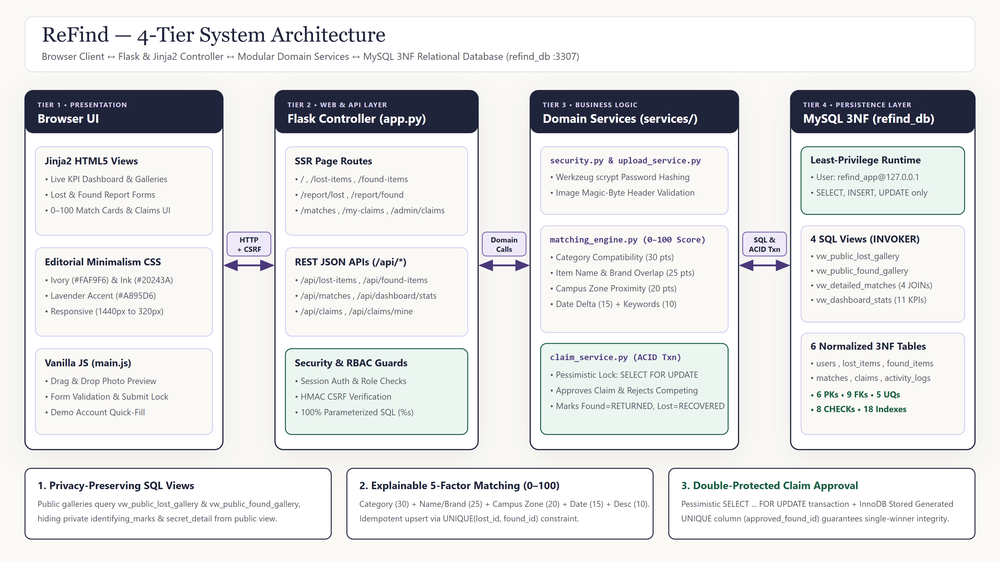
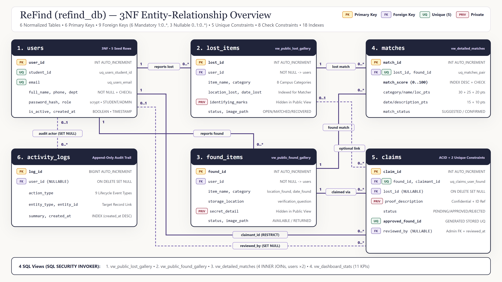
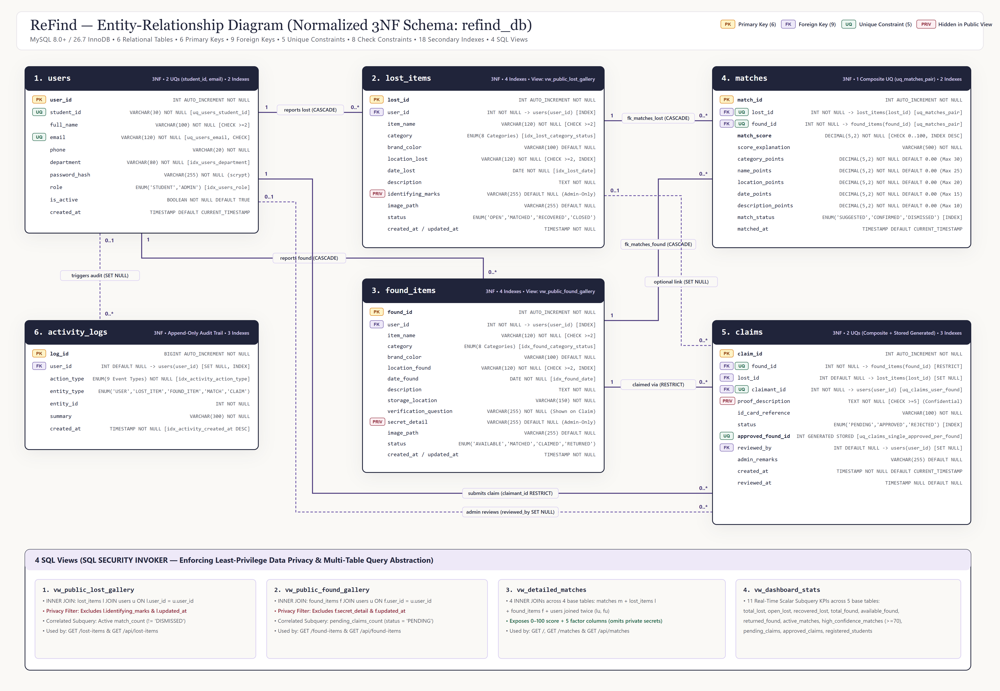
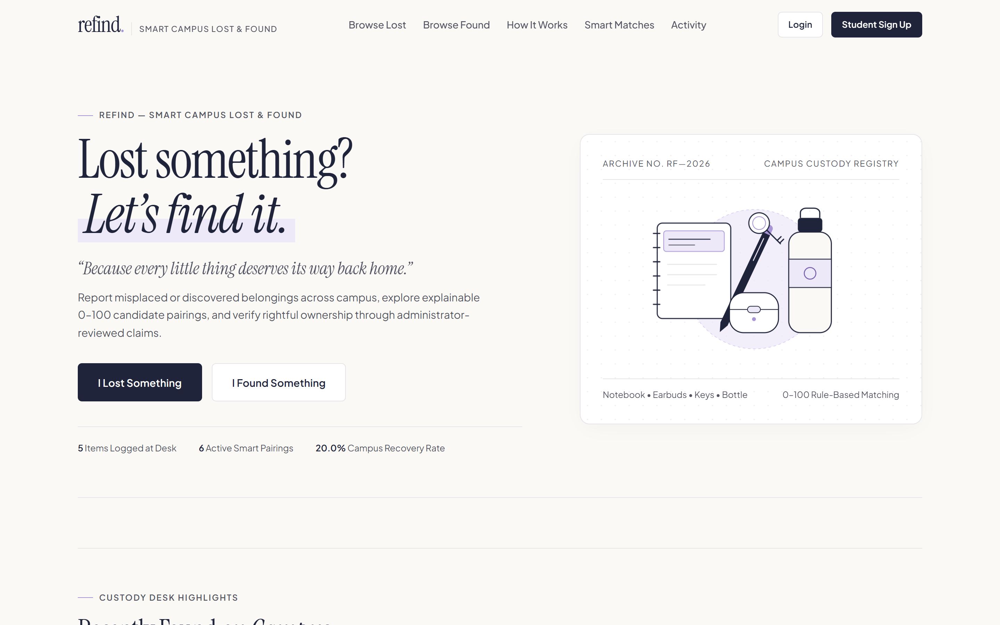
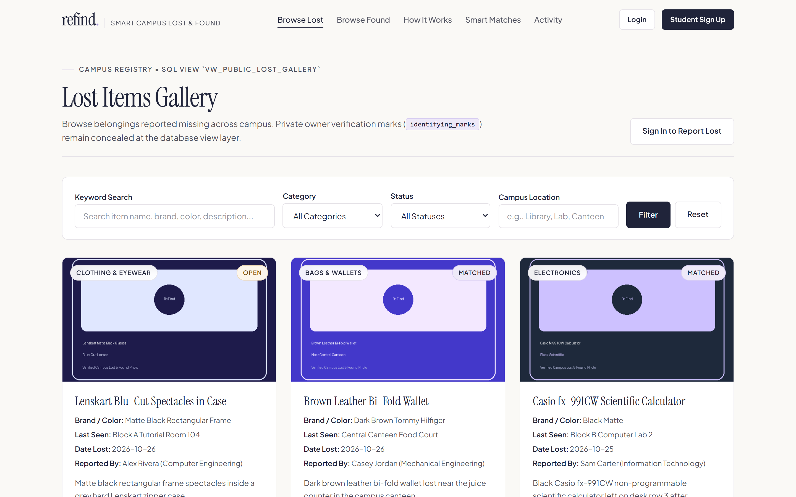
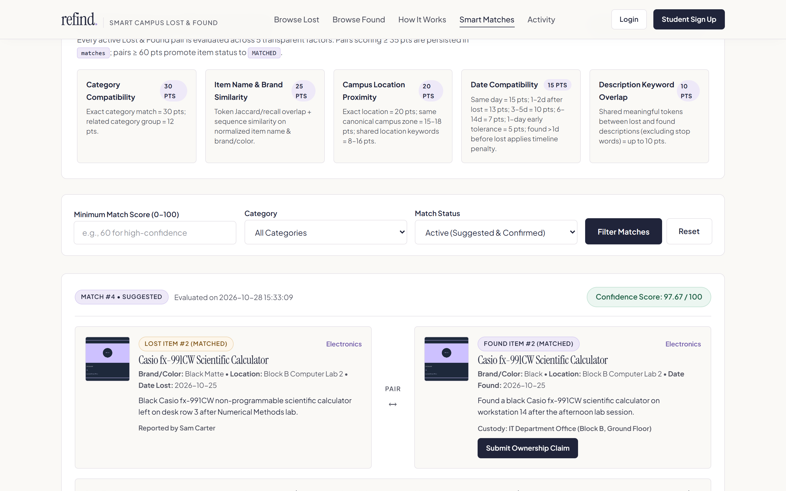
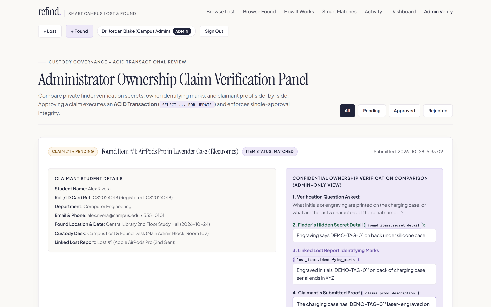

# ReFind — Smart Campus Lost & Found System

**Editorial Minimalism Web Application & Normalized 3NF Relational Database (`refind_db`)**  
*Built with Python Flask, Jinja2, Vanilla CSS/JS, and MySQL 8.0+ / 26.7 (`InnoDB`)*

---

## 1. Project Overview

**ReFind** is a full-stack relational database management system (DBMS) web application designed for university campuses to replace unstructured lost-and-found channels (chat groups, noticeboards, and paper custody registers) with a structured, privacy-preserving recovery workflow.

Students and staff can report misplaced or discovered items with validated photo uploads, browse public galleries backed by **privacy-filtering SQL Views**, inspect candidate pairings generated by an **explainable 0–100 Rule-Based Matching Engine**, and complete rightful ownership handovers through **ACID Transactions** with pessimistic row-level locking (`SELECT ... FOR UPDATE`).

---

## 2. Key Features

- **Normalized 3NF Relational Schema (`refind_db`):** Six `InnoDB` tables (`users`, `lost_items`, `found_items`, `matches`, `claims`, `activity_logs`) enforced by **6 Primary Keys**, **9 Foreign Keys**, **5 Unique Constraints**, **8 Check Constraints**, and **18 Secondary B-Tree Indexes**.
- **View-Layer Data Privacy (`SQL SECURITY INVOKER`):** Public galleries query `vw_public_lost_gallery` and `vw_public_found_gallery`, which project public item metadata while excluding confidential verification fields (`identifying_marks` and `secret_detail`) at the SQL layer so public visitors cannot fabricate ownership claims.
- **Explainable 0–100 Smart Matching Engine:** Automatically evaluates active Lost $\times$ Found item pairs across **5 weighted criteria** (Category, Name & Brand, Campus Zone Proximity, Date Compatibility, and Description Keywords) and persists component scores and human-readable explanations via idempotent `INSERT ... ON DUPLICATE KEY UPDATE`.
- **Two-Layer Single-Winner Claim Approval (ACID + Schema Guard):**
  1. **Application Transaction (`services/claim_service.py`):** Executes administrator claim approvals inside an explicit `START TRANSACTION` block using `SELECT ... FOR UPDATE` row locks to atomically approve the rightful claim, auto-reject competing pending claims, mark the found item `RETURNED`, mark the linked lost item `RECOVERED`, and write audit logs.
  2. **Storage-Engine Constraint (`database/schema.sql`):** Uses a `STORED GENERATED` column `approved_found_id` with a `UNIQUE` constraint (`uq_claims_single_approved_per_found`) so `InnoDB` physically prevents more than one `APPROVED` claim per `found_id`.
- **Defense-in-Depth Security:** Least-privilege runtime MySQL user (`refind_app` granted `SELECT, INSERT, UPDATE` only—zero `DROP` or `DELETE` privileges), Werkzeug `scrypt` password hashing, constant-time `hmac.compare_digest` CSRF protection, and magic-byte image header validation (`PNG`, `JPEG`, `WEBP`).
- **Editorial Minimalism Interface:** Responsive UI (`#FAF9F6` warm ivory, `#20243A` deep ink navy, `#A895D6` muted lavender) verified across desktop and mobile viewports (`1440px` down to `320px`).

---

## 3. Technology Stack

| Layer | Technology | Role in ReFind |
| :--- | :--- | :--- |
| **Frontend (Tier 1)** | HTML5, Jinja2, Vanilla CSS3 & ES6 JavaScript | Editorial Minimalism UI, responsive layouts (`1440px`–`320px`), client-side `FileReader` upload previews |
| **Controller (Tier 2)** | Python 3.10+ & Flask 3.1 (`app.py`) | Server-side rendered routes, REST JSON endpoints (`/api/*`), session authentication, RBAC & CSRF guards |
| **Services (Tier 3)** | `matching_engine.py`, `claim_service.py`, `upload_service.py`, `security.py` | 5-factor 0–100 scoring, transactional claim custody (`SELECT ... FOR UPDATE`), UUID magic-byte image storage |
| **Database (Tier 4)** | MySQL 8.0+ / 26.7 (`InnoDB`, `utf8mb4_unicode_ci`) | 6 normalized 3NF tables, 9 FKs, 5 UQs, 8 CHECKs, 18 secondary indexes, 4 `SQL SECURITY INVOKER` views |
| **Testing & QA** | Python `unittest`/scripts + Playwright Chrome E2E | Database integrity, REST endpoint security, Jinja2 view privacy, and real browser end-to-end verification |

---

## 4. System Architecture

ReFind follows a modular 4-tier architecture separating presentation templates, route controllers, domain services, and the least-privilege MySQL persistence layer:



> **Detailed Reference Diagram:** See [`docs/SYSTEM_ARCHITECTURE.png`](docs/SYSTEM_ARCHITECTURE.png) and editable Mermaid source [`docs/ARCHITECTURE_DIAGRAM_SOURCE.mmd.md`](docs/ARCHITECTURE_DIAGRAM_SOURCE.mmd.md).

---

## 5. Database Design (`refind_db` — 3NF Schema)

### Entity-Relationship Overview (Simplified 16:9 View)



### Complete Column-Level Entity-Relationship Diagram



> **Editable ER Source & Cardinality Proofs:** See [`docs/ER_DIAGRAM_SOURCE.mmd.md`](docs/ER_DIAGRAM_SOURCE.mmd.md) and [`docs/DBMS_TECHNICAL_SUMMARY.md`](docs/DBMS_TECHNICAL_SUMMARY.md).

### Six Core Relational Tables (3NF)

| # | Table | Primary Key | Unique Constraints | Foreign Keys & Referential Actions | Purpose |
| :---: | :--- | :--- | :--- | :--- | :--- |
| **1** | `users` | `user_id` | `uq_users_student_id`, `uq_users_email` | — | Registered students & campus administrators (`STUDENT`, `ADMIN`) with `scrypt` password hashes. |
| **2** | `lost_items` | `lost_id` | — | `user_id` $\to$ `users(user_id)` (`CASCADE`) | Lost item reports including public metadata and confidential owner `identifying_marks`. |
| **3** | `found_items` | `found_id` | — | `user_id` $\to$ `users(user_id)` (`CASCADE`) | Found item custody reports including `storage_location`, `verification_question`, and private `secret_detail`. |
| **4** | `matches` | `match_id` | `uq_matches_pair (lost_id, found_id)` | `lost_id` $\to$ `lost_items` (`CASCADE`), `found_id` $\to$ `found_items` (`CASCADE`) | Candidate pairings with 5 component point columns, total `match_score` (`0..100`), and `score_explanation`. |
| **5** | `claims` | `claim_id` | `uq_claims_user_found (found_id, claimant_id)`, `uq_claims_single_approved_per_found (approved_found_id)` | `found_id` $\to$ `found_items` (`RESTRICT`), `claimant_id` $\to$ `users` (`RESTRICT`), `lost_id` $\to$ `lost_items` (`SET NULL`), `reviewed_by` $\to$ `users` (`SET NULL`) | Ownership claims storing confidential `proof_description`, review state, and the stored generated single-approval lock column. |
| **6** | `activity_logs` | `log_id` | — | `user_id` $\to$ `users(user_id)` (`SET NULL`) | Append-only chronological audit trail for reporting, matching, claim submission, and transactional approval. |

### Four SQL Views (`SQL SECURITY INVOKER`)

1. **`vw_public_lost_gallery`**: Joins `lost_items` and `users` with a correlated subquery for active `match_count`, intentionally omitting `identifying_marks`.
2. **`vw_public_found_gallery`**: Joins `found_items` and `users` with a correlated subquery for `pending_claims_count`, intentionally omitting `secret_detail`.
3. **`vw_detailed_matches`**: Performs 4 `INNER JOIN`s across `matches`, `lost_items`, `found_items`, and `users` (aliased as `lu` and `fu`) for side-by-side comparison without exposing private verification fields.
4. **`vw_dashboard_stats`**: Aggregates 11 real-time scalar KPIs across `lost_items`, `found_items`, `matches`, `claims`, and `users`.

---

## 6. Explainable 5-Factor Matching Algorithm (0–100 Score)

Implemented in [`services/matching_engine.py`](services/matching_engine.py), every active Lost $\times$ Found pair is evaluated using a transparent 100-point rubric:

$$\text{Match Score (0–100)} = S_{\text{category}} (30) + S_{\text{name}} (25) + S_{\text{location}} (20) + S_{\text{date}} (15) + S_{\text{description}} (10)$$

| Factor | Max Points | Scoring Logic |
| :--- | :---: | :--- |
| **1. Category Compatibility** | `30.0` | Exact category match = `30.0 pts`; compatible campus group (e.g., `Bags & Wallets` $\leftrightarrow$ `ID & Cards`) = `12.0 pts`. |
| **2. Item Name & Brand** | `25.0` | `70%` token Jaccard/recall overlap + `30%` `SequenceMatcher` character similarity across `item_name` and `brand_color`. |
| **3. Campus Zone Proximity** | `20.0` | Exact normalized location = `20.0 pts`; canonical campus zone match (`Library`, `Canteen`, `Block B Lab`, `Auditorium`) = `15.0–18.0 pts`. |
| **4. Date Compatibility** | `15.0` | Same day (`0d`) = `15.0 pts`; `1–2d` after lost = `13.0 pts`; `3–5d` = `10.0 pts`; `6–14d` = `7.0 pts`; found $>1\text{d}$ before lost applies a `0.35x` penalty. |
| **5. Description Keywords** | `10.0` | Stop-word-filtered keyword intersection between `lost_items.description` and `found_items.description`. |

- **Persistence Thresholds:** Pairs scoring $\ge 35.0$ are upserted into `matches` (`ON DUPLICATE KEY UPDATE`); pairs scoring $\ge 60.0$ automatically promote `OPEN`/`AVAILABLE` items to `MATCHED`.

---

## 7. Ownership Claim & Admin ACID Approval Workflow

Algorithmic matches suggest likely pairings, but physical handover requires verified proof of ownership:

1. **Claim Submission (`POST /claims/submit/<found_id>`):** A student answers the item's `verification_question`, provides a confidential `proof_description` and campus ID reference, and optionally links their `lost_id`.
2. **Side-by-Side Admin Review (`GET /admin/claims`):** A campus administrator compares:
   - The finder's hidden `found_items.secret_detail`
   - The owner's hidden `lost_items.identifying_marks`
   - The claimant's submitted `claims.proof_description`
3. **Atomic Custody Transfer (`POST /admin/claims/<claim_id>/decision`):**
   - `approve_claim_transaction()` in [`services/claim_service.py`](services/claim_service.py) acquires pessimistic row locks (`SELECT ... FROM claims c INNER JOIN found_items f ... FOR UPDATE`).
   - Sets the winning claim to `APPROVED` (populating `approved_found_id = found_id`), auto-rejects all competing `PENDING` claims on that `found_id`, updates `found_items.status = 'RETURNED'` and `lost_items.status = 'RECOVERED'`, confirms the match in `matches`, records audit entries in `activity_logs`, and commits atomically (`conn.commit()`).

---

## 8. Application Screenshots

| 1. Editorial Homepage & Live KPI Dashboard (`GET /`) | 2. Public Lost Items Gallery (`GET /lost-items`) |
| :---: | :---: |
|  |  |
| **3. 0–100 Smart Matching Engine (`GET /matches`)** | **4. Admin ACID Claim Verification (`GET /admin/claims`)** |
|  |  |

---

## 9. Installation & Local Setup Instructions

### Prerequisites
- **Python:** `3.10+`
- **MySQL Server:** `8.0+` (or MySQL Innovation `26.x` with `InnoDB`)

### Step 1 — Clone the Repository & Create a Virtual Environment

```powershell
git clone https://github.com/tanishqawatekar-cpu/reFind.git
cd reFind

python -m venv .venv
.\.venv\Scripts\Activate.ps1
pip install -r requirements.txt
```

### Step 2 — Configure Environment Variables (`.env`)

Copy `.env.example` to `.env` and provide your local placeholders (`.env` is gitignored and never committed):

```powershell
Copy-Item .env.example .env
```

```ini
# .env (Safe Placeholder Example)
FLASK_SECRET_KEY=your_flask_secret_key_here
FLASK_ENV=development
FLASK_PORT=5000

# MySQL Connection Settings
DB_HOST=localhost
DB_PORT=3307
DB_NAME=refind_db

# Dedicated Least-Privilege Runtime User (SELECT, INSERT, UPDATE only)
DB_USER=refind_app
DB_PASSWORD=your_refind_app_password_here

# Root Account (Used ONLY by database/init_db.py during initial provisioning)
DB_ROOT_USER=root
DB_ROOT_PASSWORD=your_mysql_root_password_here

MAX_UPLOAD_MB=5
```

### Step 3 — Verify MySQL Compatibility & Initialize `refind_db`

Run the read-only MySQL verification script followed by the idempotent schema and seed initializer:

```powershell
# 1. Verify MySQL server connectivity and feature support (read-only)
python database/verify_mysql.py

# 2. Create refind_db, 6 tables, 4 SQL views, refind_app user, and sample data
python database/init_db.py
```

Alternatively, you can execute [`database/schema.sql`](database/schema.sql) directly in **MySQL Workbench**.

### Step 4 — Start the Flask Application

```powershell
python app.py
```

Open **`http://127.0.0.1:5000`** in your browser.

---

## 10. Testing & Verification Summary

All automated verification suites and read-only SQL demonstrations are included in the repository (see [`docs/STAGE4_TEST_REPORT.md`](docs/STAGE4_TEST_REPORT.md) and [`docs/DBMS_SQL_DEMONSTRATIONS.sql`](docs/DBMS_SQL_DEMONSTRATIONS.sql)):

| Verification Suite | Command / Script | Result | Key Assertions Verified |
| :--- | :--- | :---: | :--- |
| **Database Integrity Suite** | `python database/test_db_integrity.py` | **PASS (`6/6`)** | Least-privilege `refind_app` grants, 9 FKs with 0 orphans, `scrypt` password hashes, 4 SQL views |
| **Backend API & Security Suite** | `python database/test_backend_endpoints.py` | **PASS (`9/9`)** | REST JSON endpoints, CSRF/Auth guards, spoofed PNG header rejection (`HTTP 400`), ACID claim approval |
| **Frontend Jinja2 Views Suite** | `python database/test_frontend_views.py` | **PASS (`7/7`)** | All 13 Jinja2 templates, gallery filters, and non-exposure of `identifying_marks` & `secret_detail` |
| **Browser E2E & Responsive QA** | `python database/test_stage4_browser_e2e.py` | **PASS (`8/8` E2E + `5/5` Viewports)** | Full Chrome E2E workflows and zero horizontal overflow across `1440px`, `1024px`, `768px`, `375px`, and `320px` |
| **Overall Stage 4 QA Report** | [`docs/STAGE4_TEST_REPORT.md`](docs/STAGE4_TEST_REPORT.md) | **PASS (`30/30`)** | 100% pass rate with zero console errors and preserved baseline records |

---

## 11. Repository Structure

```text
ReFind/
├── app.py                              # Flask application routes (SSR + REST JSON APIs)
├── config.py                           # Environment-backed configuration loader
├── requirements.txt                    # Python package dependencies
├── .env.example                        # Safe environment variable template
├── database/
│   ├── schema.sql                      # MySQL 3NF DDL (6 tables, 9 FKs, 5 UQs, 4 SQL views)
│   ├── db.py                           # Connection helper & ACID db_transaction() context manager
│   ├── init_db.py                      # Idempotent database, least-privilege user & seed initializer
│   ├── verify_mysql.py                 # Read-only MySQL compatibility checker
│   ├── test_db_integrity.py            # Database schema, FK, view & privilege test suite (6/6)
│   ├── test_backend_endpoints.py       # Backend API, CSRF, upload & ACID transaction test suite (9/9)
│   ├── test_frontend_views.py          # Jinja2 template & privacy filter test suite (7/7)
│   └── test_stage4_browser_e2e.py      # Chrome E2E & responsive viewport test suite
├── services/
│   ├── matching_engine.py              # Explainable 5-factor (0–100) rule-based matching engine
│   ├── claim_service.py                # Pessimistic SELECT ... FOR UPDATE claim verification service
│   ├── upload_service.py               # Magic-byte validated UUID image upload service
│   └── security.py                     # Session authentication, RBAC decorators & HMAC CSRF guards
├── templates/                          # 13 Jinja2 HTML templates (Editorial Minimalism UI)
├── static/                             # CSS stylesheet, client-side JS, and sample item illustrations
└── docs/                               # ER diagrams, architecture diagrams, SQL demos & QA reports
```

---

## 12. Future Scope

1. **MySQL `FULLTEXT` Natural-Language Indexing:** Add `FULLTEXT INDEX` on `(item_name, description)` using `MATCH(...) AGAINST(... IN NATURAL LANGUAGE MODE)` for large multi-campus item catalogs.
2. **Database Triggers & Instant Notification Queue:** Introduce an `AFTER INSERT ON matches` trigger (for `match_score >= 75.00`) to enqueue automated email/SMS match alerts for students.
3. **QR-Code Physical Custody Tags:** Generate printable QR custody labels linked to `found_items.found_id` and `storage_location` for rapid desk check-in and handover verification.
4. **Automated Archival & Table Partitioning:** Use MySQL Scheduled Events (`CREATE EVENT`) and range partitioning on `activity_logs(created_at)` to archive resolved records across academic years.
5. **University SSO (`OAuth2` / `LDAP`) Integration:** Link `users.student_id` and `users.email` directly with campus smart-card and single sign-on directories.
