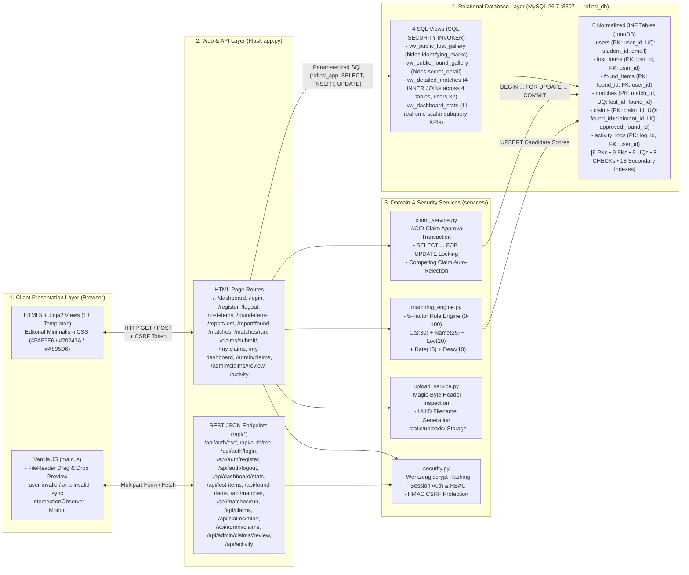

# ReFind — System Architecture Diagram Sources (`ARCHITECTURE_DIAGRAM_SOURCE.mmd.md`)

This file contains both the **Simplified Presentation-Friendly Architecture Diagram** (for 16:9 slide projection) and the **Detailed Technical Reference Architecture Diagram**, verified against the exact routes in [`app.py`](file:///C:/Projects/ReFind/app.py) and [`database/schema.sql`](file:///C:/Projects/ReFind/database/schema.sql).

---

## 1. Simplified Presentation-Friendly Architecture Diagram (Slide Version)

Rendered to [`docs/SYSTEM_ARCHITECTURE_PRESENTATION.svg`](file:///C:/Projects/ReFind/docs/SYSTEM_ARCHITECTURE_PRESENTATION.svg) and [`docs/SYSTEM_ARCHITECTURE_PRESENTATION.png`](file:///C:/Projects/ReFind/docs/SYSTEM_ARCHITECTURE_PRESENTATION.png) (`1920×1080` widescreen).

```mermaid
flowchart LR
    subgraph P1["Tier 1: Browser UI"]
        Views1["Jinja2 HTML5 Templates\n+ Editorial Minimalism CSS\n+ Vanilla JS (main.js)"]
    end

    subgraph P2["Tier 2: Flask Controller (app.py)"]
        Routes["SSR Page Routes & REST JSON APIs\n/, /lost-items, /found-items, /matches\n/api/lost-items, /api/found-items,\n/api/matches, /api/claims, /api/claims/mine"]
        Guards["Security & RBAC Guards\nSession Auth + HMAC CSRF + %s SQL"]
    end

    subgraph P3["Tier 3: Domain Services (services/)"]
        SecUp["security.py & upload_service.py\nscrypt Hashing + Magic-Byte Check"]
        Matcher["matching_engine.py\n0–100 Rule-Based Scoring (5 Factors)"]
        ClaimSvc["claim_service.py\nACID Transaction (SELECT FOR UPDATE)"]
    end

    subgraph P4["Tier 4: MySQL 3NF (refind_db :3307)"]
        SQLViews["4 SQL Views (SQL SECURITY INVOKER)\nHides identifying_marks & secret_detail"]
        Tables3NF["6 Normalized 3NF Tables (InnoDB)\n6 PKs • 9 FKs • 5 UQs • 8 CHECKs • 18 Indexes"]
    end

    P1 <-->|"HTTP + CSRF"| P2
    P2 <-->|"Domain Calls"| P3
    P3 <-->|"Parameterized SQL\n& ACID Transactions"| P4
```

---

## 2. Detailed Technical Reference Architecture Diagram (Documentation Version)

Rendered to [`docs/SYSTEM_ARCHITECTURE.svg`](file:///C:/Projects/ReFind/docs/SYSTEM_ARCHITECTURE.svg) and [`docs/SYSTEM_ARCHITECTURE.png`](file:///C:/Projects/ReFind/docs/SYSTEM_ARCHITECTURE.png).

