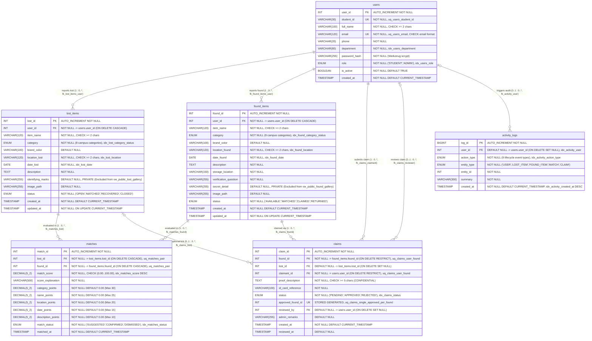

# ReFind (`refind_db`) — Editable Entity-Relationship Diagram Source (Normalized 3NF Schema)

This file contains the editable **Mermaid (`erDiagram`)** source and **Foreign-Key / Unique-Constraint / Secondary-Index** specification for the normalized 6-table 3NF relational schema implemented in [`database/schema.sql`](file:///C:/Projects/ReFind/database/schema.sql).

---

## 1. Mermaid ER Diagram (`erDiagram`)

---

## 2. Verified Relationship Cardinalities & Foreign Key Referential Actions (9 Foreign Keys)

| # | Foreign Key Constraint | Parent Table (Referenced) | Child Table & Column | Child Nullability | Verified Cardinality (Parent : Child) | `ON DELETE` | `ON UPDATE` |
| :---: | :--- | :--- | :--- | :---: | :---: | :---: | :---: |
| 1 | `fk_lost_items_user` | `users(user_id)` | `lost_items(user_id)` | `NOT NULL` | **`1 : 0..*`** (Mandatory parent) | `CASCADE` | `CASCADE` |
| 2 | `fk_found_items_user` | `users(user_id)` | `found_items(user_id)` | `NOT NULL` | **`1 : 0..*`** (Mandatory parent) | `CASCADE` | `CASCADE` |
| 3 | `fk_matches_lost` | `lost_items(lost_id)` | `matches(lost_id)` | `NOT NULL` | **`1 : 0..*`** (Mandatory parent) | `CASCADE` | `CASCADE` |
| 4 | `fk_matches_found` | `found_items(found_id)` | `matches(found_id)` | `NOT NULL` | **`1 : 0..*`** (Mandatory parent) | `CASCADE` | `CASCADE` |
| 5 | `fk_claims_found` | `found_items(found_id)` | `claims(found_id)` | `NOT NULL` | **`1 : 0..*`** (Mandatory parent) | `RESTRICT` | `RESTRICT` |
| 6 | `fk_claims_lost` | `lost_items(lost_id)` | `claims(lost_id)` | `DEFAULT NULL` | **`0..1 : 0..*`** (Optional parent) | `SET NULL` | `CASCADE` |
| 7 | `fk_claims_claimant` | `users(user_id)` | `claims(claimant_id)` | `NOT NULL` | **`1 : 0..*`** (Mandatory parent) | `RESTRICT` | `CASCADE` |
| 8 | `fk_claims_reviewer` | `users(user_id)` | `claims(reviewed_by)` | `DEFAULT NULL` | **`0..1 : 0..*`** (Optional parent) | `SET NULL` | `CASCADE` |
| 9 | `fk_activity_user` | `users(user_id)` | `activity_logs(user_id)` | `DEFAULT NULL` | **`0..1 : 0..*`** (Optional parent) | `SET NULL` | `CASCADE` |

---

## 3. Reconciliation of `UNIQUE` Constraints (5) vs. Non-Unique Secondary Indexes (18)

| Category | Count | Exact Identifiers in `database/schema.sql` & `information_schema` |
| :--- | :---: | :--- |
| **`PRIMARY KEY` Constraints** | **6** | `users(user_id)`, `lost_items(lost_id)`, `found_items(found_id)`, `matches(match_id)`, `claims(claim_id)`, `activity_logs(log_id)` |
| **`UNIQUE` Constraints (Backed by Unique Indexes)** | **5** | 1. `uq_users_student_id` on `users(student_id)` 2. `uq_users_email` on `users(email)` 3. `uq_matches_pair` on `matches(lost_id, found_id)` 4. `uq_claims_user_found` on `claims(found_id, claimant_id)` 5. `uq_claims_single_approved_per_found` on `claims(approved_found_id)` (Stored Generated Column) |
| **Non-Unique Secondary `INDEX`es** | **18** | • `users` (2): `idx_users_role`, `idx_users_department` • `lost_items` (4): `idx_lost_category_status`, `idx_lost_date`, `idx_lost_location`, `idx_lost_user` • `found_items` (4): `idx_found_category_status`, `idx_found_date`, `idx_found_location`, `idx_found_user` • `matches` (2): `idx_matches_score (DESC)`, `idx_matches_status` • `claims` (3): `idx_claims_found_status`, `idx_claims_claimant`, `idx_claims_status` • `activity_logs` (3): `idx_activity_created_at (DESC)`, `idx_activity_action_type`, `idx_activity_user` |
